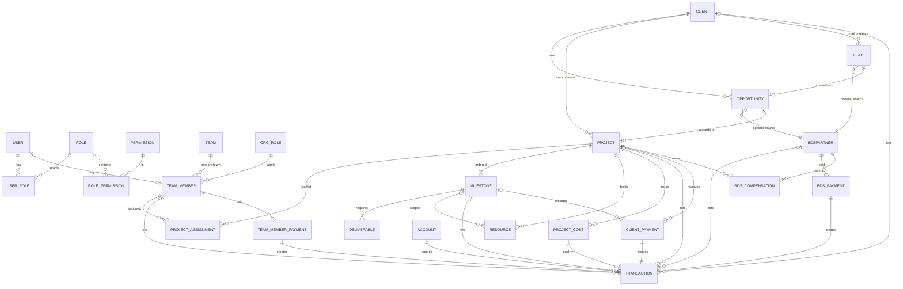

# Requirements Analysis — Small Company Management System

> **Source:** `resources/company_management_system_project_overview.md`
> **Status:** Analysis complete · v1.0 · 2026-08-22
> **Companion documents:** `requirement-gaps.md`, `development-plan.md`, `deployment-plan.md`, `task-breakdown.md`

---

## 1. Executive Summary

The project is an internal company management system for a small company (≤5 users, low usage — roughly monthly data-entry sessions). It connects the full business pipeline in one place:

**CRM → Projects → Milestones/Deliverables → Finance**, with organizational team management, external BDS partner tracking, a ledger-driven financial core, granular RBAC, and audit trails.

It is explicitly **not an ERP**: no payroll engine, no automatic payments, no double-entry accounting, no task management. The emphasis is on *reliable financial traceability* with a deliberately small feature surface.

### Locked product decisions

| Decision | Value |
|---|---|
| Frontend | Next.js 15 (App Router, RSC/SSR) + PWA via Serwist |
| Backend | NestJS 11 REST API |
| Database | PostgreSQL 16 (self-hosted) |
| ORM | Prisma |
| Auth | JWT (access + refresh), Super Admin bootstrap |
| Hosting | Oracle Cloud Always Free ARM VM (single VM, Docker Compose: nginx + web + api + postgres) |
| Domain | sslip.io hostname derived from reserved public IP (`https://<ip-dashed>.sslip.io`) |
| CI/CD | GitHub Actions → GHCR images → SSH deploy to VM |
| Backups | Nightly `pg_dump` → rclone → Backblaze B2 free tier |
| Scale target | ≤5 users, ~monthly usage bursts |

---

## 2. Scope

### 2.1 In scope (v1 / MVP)

1. Authentication, users, roles, permissions (allow-only RBAC), audit logs
2. Teams and internal team members (organizational management)
3. CRM: clients, leads, opportunities, follow-up status flows
4. BDS partners: external business developers with attribution + fixed compensation
5. Opportunity → project conversion carrying commercial data
6. Projects with ordered milestones and deliverables
7. Milestone work/payment dual-status lifecycle; next milestone never blocked by payment
8. Manual client/milestone payment recording (partial payments supported)
9. Manual team-member and BDS payment recording
10. Project costs (paid vs unpaid → payable)
11. Financial ledger: accounts, transactions, derived balances/receivables/payables
12. Project & milestone **resource files** (see §8 — added requirement)
13. Dashboards (company + finance), reports, search/filter/pagination
14. PWA installability for mobile pinning

### 2.2 Explicit non-goals (from spec §30)

Automatic payment gateways/bank integration · automatic disbursement/payroll · bank reconciliation · double-entry bookkeeping · tax engine · HR/attendance/recruitment · procurement/inventory · marketing automation · Gantt charts · task management · time tracking · AI features · workflow builders · multi-company · multi-currency.

---

## 3. Core Principles (spec §2, distilled)

| # | Principle | Consequence for build |
|---|---|---|
| P1 | **Finance is ledger-driven** | No stored mutable balance anywhere. Every money movement = one `Transaction` row. Balances are always computed: `opening + ΣIN − ΣOUT`. Adjustments/opening balances enter as transactions too. |
| P2 | **Work status ≠ payment status** | Two independent state machines per milestone. UI shows both everywhere. Payment state never gates work actions. |
| P3 | **Milestones start independently of payment** | Sequence governs availability of the *next* milestone's work; unpaid previous milestones never block progression. Optional "payment gate" config is future-only; must not exist in v1 logic. |
| P4 | **Projects are milestone-driven** | No completion percentage in v1. Progress = ordered milestones × (work, payment) states. |
| P5 | **Teams are organizational, not project-role based** | No `role_on_project` field anywhere. Org role is a centrally managed label; access comes only from RBAC permissions. |
| P6 | **BDS partners are external** | Separate entity type from TeamMember/User. Tracked by attribution → compensation → paid/outstanding → history. |
| P7 | **All payments are manual** | Every payment entry captures: amount, date, TRX ID, method/account, note, related party/project/milestone. Saving a payment record creates exactly one transaction atomically. |

---

## 4. Module Overview (spec §3)

```text
Company Management System
├── Dashboard            (financial + operational summaries, attention items)
├── CRM / Sales          (clients, leads, opportunities, conversion)
├── Projects             (projects, milestones, deliverables, resources*)
├── Organization         (teams, team members, org roles, assignments)
├── BDS Partners         (partners, attribution, compensation, payments)
├── Finance              (accounts, transactions, receivables, payables,
│                         project costs, team/BDS payments, reports)
└── Administration       (users, roles, permissions, audit logs, settings)
```

`*` = requirement added during planning (not in original spec §3 tree).

---

## 5. Domain Entity Inventory (~24 entities)

### Identity & Access
| Entity | Key fields | Notes |
|---|---|---|
| **User** | name, email (unique), passwordHash, status, lastLoginAt, optional teamMemberId | Not every user must be a team member |
| **Role** | name (unique), description, status | Permission bundle; SUPER_ADMIN is a protected built-in |
| **Permission** | key (`resource.action`, normalized lowercase) | Seeded catalog from spec §21.4 (~60 keys); not CRUD-editable in v1 |
| **UserRole** (join) | userId, roleId | Union semantics for effective permissions |
| **RolePermission** (join) | roleId, permissionKey | |

### Organization
| Entity | Key fields | Notes |
|---|---|---|
| **Team** | name (unique), description, leadMemberId?, status | Super Admin managed |
| **TeamMember** | name, contact, primaryTeamId?, orgRoleId?, status, joinedAt | Internal people; may exist without User account |
| **OrgRole** | name (unique) | Label only: Developer, Designer, PM, Sales… centrally managed |
| **ProjectAssignment** | teamMemberId, projectId, startDate, endDate?, status, notes | No role field (P5) |

### CRM
| Entity | Key fields | Notes |
|---|---|---|
| **Client** | name, companyName?, phone, email, address, notes, status (Active/Inactive/Archived) | Audit columns (createdBy/updatedBy/at) on all master entities |
| **Lead** | name, company, contact info, source, assignedUserId, bdsPartnerId?, status (New→Contacted→Qualified→Converted/Lost) | Converted implies link to client/opportunity |
| **Opportunity** | clientId/prospectRef, title, estimatedValue, expectedCloseDate, assignedUserId, bdsPartnerId?, stage (Qualified→Proposal Sent→Negotiation→Won/Lost) | Won → conversion flow to project |

### Delivery
| Entity | Key fields | Notes |
|---|---|---|
| **Project** | code (unique), name, clientId, description, ownerId?, startDate, expectedEndDate, actualEndDate?, status (Draft/Planning/Active/On Hold/Completed/Cancelled), contractValue | Primary operational unit |
| **Milestone** | projectId, name, description, sequence, startDate?, dueDate?, completedAt?, amount, paymentDueDate?, workStatus, paymentStatus | Dual statuses; see rules §6 |
| **Deliverable** | milestoneId, name, description, dueDate?, required flag, status (Pending→In Progress→Submitted→Under Review→Approved/Rejected), submittedAt/approvedAt/approvedById | Gates milestone completion when required |
| **Resource** *(new)* | projectId (required), milestoneId? (nullable), title, storagePath, originalFilename, mimeType, sizeBytes, uploadedById | Tag = Project \| Milestone (derived from linkage). See §8 |

### BDS
| Entity | Key fields | Notes |
|---|---|---|
| **BDSPartner** | name, phone, email, paymentTerms, notes, status | External person; never a TeamMember |
| **BDSCompensation** | partnerId, projectId, agreedAmount, paymentDueDate?, status | Fixed-amount v1; percentage later |

### Finance
| Entity | Key fields | Notes |
|---|---|---|
| **Account** | name (unique), type (Cash/Bank/MFS), openingBalance, currency (BDT v1), status | Balance always derived |
| **TransactionCategory** | name (unique), direction (IN/OUT), active | Configurable by admins; seeded from spec §11.2 |
| **Transaction** | date, accountId, direction (IN/OUT), amount ≥ 0, categoryId, method, trxId, note, optional FKs: projectId/clientId/teamMemberId/bdsPartnerId/milestoneId, refType/refId, reversedById? | Immutable after posting except reversal link; see rules §6 |
| **ClientPayment** | projectId, milestoneId?, amount, receivedDate, accountId, method, trxId, note | Saving ⇒ exactly one IN Transaction (atomic) |
| **TeamMemberPayment** | teamMemberId, projectId?, amount, paidDate, … | ⇒ exactly one OUT Transaction |
| **BDSPayment** | bdsPartnerId, projectId?, amount, paidDate, … | ⇒ exactly one OUT Transaction |
| **ProjectCost** | projectId, categoryId, description, amount, date, paid flag, vendorName?, account?/trxId? if paid | Unpaid cost ⇒ payable; paying it ⇒ OUT Transaction flips paid=true |
| **AuditLog** | userId, action, entityType, entityId, before?/after? (JSON), timestamp, ip? | Append-only |

**Modeling decisions recorded**
- Receivables/payables are **derived views**, not stored tables (except where a gap decision adds accrual records — see `requirement-gaps.md` F-1/F-2).
- Deliverable attachments and project/milestone resources should unify onto the single **Resource** table (gap D-1).
- `Overdue` is never stored — display-time derivation only.

---

## 6. Entity Relationship Map



---

## 7. Business Rules & Invariants

### 7.1 Ledger invariants (highest priority)

| ID | Rule |
|---|---|
| L1 | Account balance is **only ever computed**: `openingBalance + Σ(IN) − Σ(OUT)` per account; company total = Σ active accounts. No editable balance field exists. |
| L2 | Each payment record (ClientPayment / TeamMemberPayment / BDSPayment) creates **exactly one** Transaction in the same DB transaction. Orphan payment records or unlinked transactions are bugs. |
| L3 | Posted transactions are **never hard-deleted or edited**. Correction = linked reversal/adjustment transaction (`refType='REVERSAL'`, `refId=original.id`). Reversal permission is separate (`transactions.reverse`). |
| L4 | Amounts are non-negative; direction carries sign. Currency is BDT (৳) throughout v1. |
| L5 | Opening balances and manual adjustments are themselves transactions with clear notes (auditable). |

### 7.2 Milestone lifecycle rules

| ID | Rule |
|---|---|
| M1 | Work status machine: `Pending → In Progress → Completed` (+ optional On Hold / Cancelled). |
| M2 | Payment status machine: `Not Due → Pending → Partially Paid → Paid`. Transition to `Pending` happens at **completion time or paymentDueDate arrival — decision needed** (gap F-3; default recommendation: becomes Pending when milestone completes). |
| M3 | `Overdue` is derived at read time: `(Pending ∨ PartiallyPaid) ∧ paymentDueDate < today`. Never stored. |
| M4 | Starting/completing milestone *N+1* must **never** require milestone *N* payment (P3). Sequence only gates work readiness. |
| M5 | Milestones have explicit `sequence`; reorder allowed but sequence stays contiguous within a project. |
| M6 | A milestone may be marked Completed when all **required** deliverables are Approved. Authorized users may override with a mandatory reason (stored on audit log). Cancelled milestones are excluded from financial aggregations (gap F-7 confirms treatment). |

### 7.3 Money-movement side effects (from spec §12–§15)

Saving each entry type must atomically perform:

| Entry | Side effects |
|---|---|
| **Client/milestone payment** | ClientPayment row → one IN Transaction → milestone paid-total ↑ → milestone paymentStatus recomputed → project received/due/not-yet-due recomputed (derived views just re-query). Partial allocations validated ≤ milestone amount. |
| **Team member payment** | TeamMemberPayment row → one OUT Transaction → member totals ↑ → payable ↓ (per accrual model, gap F-1) → if project-linked, counts as project cost. |
| **BDS payment** | BDSPayment row → one OUT Transaction → partner totals ↑ → compensation outstanding ↓ → if project-linked, counts as project cost. |
| **Project cost (paid)** | ProjectCost row(paid=true) → one OUT Transaction immediately. |
| **Project cost (unpaid)** | ProjectCost row(paid=false) → appears under payables. Later "record payment" action → OUT Transaction + flip paid=true. |

### 7.4 Derived calculations

```text
Account balance        = openingBalance + Σ(IN) − Σ(OUT)
Company balance        = Σ balances(active accounts)

Received (project)     = Σ clientPayments(project)
Currently Due          = Σ milestone.amount where due-date reached/pending-rule
                         − Σ payments allocated to those milestones
Not Yet Due            = Σ milestone.amount not yet triggered
Overdue                = subset of Currently Due past paymentDueDate

Expected Gross Profit  = contractValue − Σ projectCosts (paid + unpaid)

BDS Outstanding        = Σ agreedAmount − Σ bdsPayments(partner, project)

Payables breakdown     = TeamMembers (accrual rule TBD, gap F-1)
                       + BDS partners (compensation − paid)
                       + Other (Σ unpaid project costs)
```

### 7.5 RBAC & access invariants

| ID | Rule |
|---|---|
| A1 | Single built-in role `SUPER_ADMIN`; cannot be deleted/deactivated below "≥1 active" floor. |
| A2 | Effective permissions = union over active roles (**allow-only**; no deny rules in v1). |
| A3 | Permission keys normalized `resource.action` lowercase (spec §21.4 catalog seeded verbatim minus whitespace typo). |
| A4 | Sensitive finance actions separately keyed: `*.payments.create/update/reverse`, `transactions.create/reverse/view`. Viewing finance ≠ moving money. |
| A5 | Every create/update/delete/status-change on sensitive entities writes an AuditLog entry with actor + before/after snapshots. |

---

## 8. Added Requirement — Project & Milestone Resources

*(Captured during planning; not part of original spec text.)*

1. Resource files can be uploaded **for each project**.
2. Files may optionally be attached to a **milestone** ("shared files" per milestone).
3. The Project page shows a Resources tab listing all files with:
   - a **tag badge** per row: `Project` or `Milestone`;
   - a **milestone dropdown filter** ("Shared files by milestone") showing which milestone owns which files;
   - uploader + date metadata.
4. Milestone detail page shows its scoped file subset.
5. Downloads are auth-gated (NestJS authorizes, nginx serves via `X-Accel-Redirect`).
6. New permission group: `resources.view/create/update/delete`.
7. Storage: local Docker volume behind nginx `/files/*` (internal); DB stores metadata only.

Open sub-decisions tracked as gaps D-1..D-4 (attachment unification, size/type limits, version-overwrite policy, delete rules).

---

## 9. Dashboard & Reporting Summary

**Company Dashboard:** balance, receivable, payable, paid-to-team, paid-to-BDS, project costs, month net cash flow + operational lists (active projects, current milestones, awaiting-payment milestones, overdue milestones, upcoming deadlines, open leads/opportunities, assignment counts) + attention items feed.

**Finance Dashboard:** balance trio + this-month received/disbursed/net + category breakdown.

**Reports (v1):** company (balances, income/disbursement by period, receivables, payables, people payouts), project (contract value, received/due/not-yet-due, costs, gross profit, milestone payment matrix), people (assignments, payment histories, BDS outstanding). CSV export (`reports.export`).

**Attention items engine:** completed-but-unpaid milestones, overdue client payments, deadlines within N days, deliverables awaiting review, any outstanding payables.

## 10. Screen Inventory (30 screens, spec §25)

All 30 screens from spec §25 are in scope, with these consolidations allowed: deliverable detail inside milestone page tabs; project assignments inside team-member & project pages; payment entry as modal/dedicated screen reachable from context (project, milestone, finance dashboard).

## 11. Search / Filter / Pagination

Every major list (clients, projects, team members, BDS partners, transactions, milestones, payments) supports search, filtering, sorting, pagination. Transactions additionally filter by date range, account, category, project, client, member, partner, direction, status.

## 12. Non-Functional Posture (given locked stack)

| Concern | Position |
|---|---|
| Scale | 5 concurrent users worst case; trivial load |
| Availability | Best-effort single VM; nightly offsite backups; documented restore |
| Security | HTTPS everywhere (Let's Encrypt), JWT short-lived access tokens, bcrypt/argon2 hashing, rate limiting, allow-only RBAC, audit trail |
| Localization | English UI, BDT currency formatting, Asia/Dhaka timezone assumption (confirm gap E-3) |
| Mobile | PWA-first responsive design; installable app shell |
| Observability | Structured JSON logs, `/health` endpoint, uptime monitor, disk-space alert cron |
