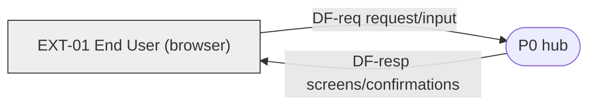
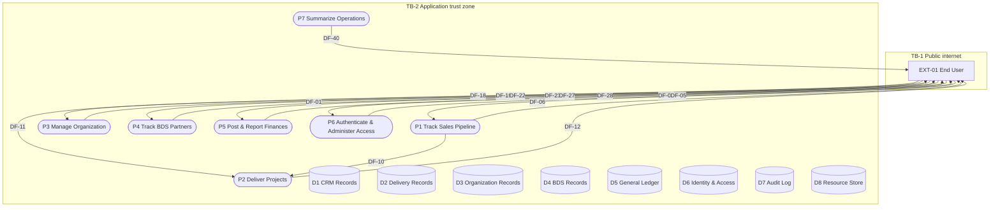
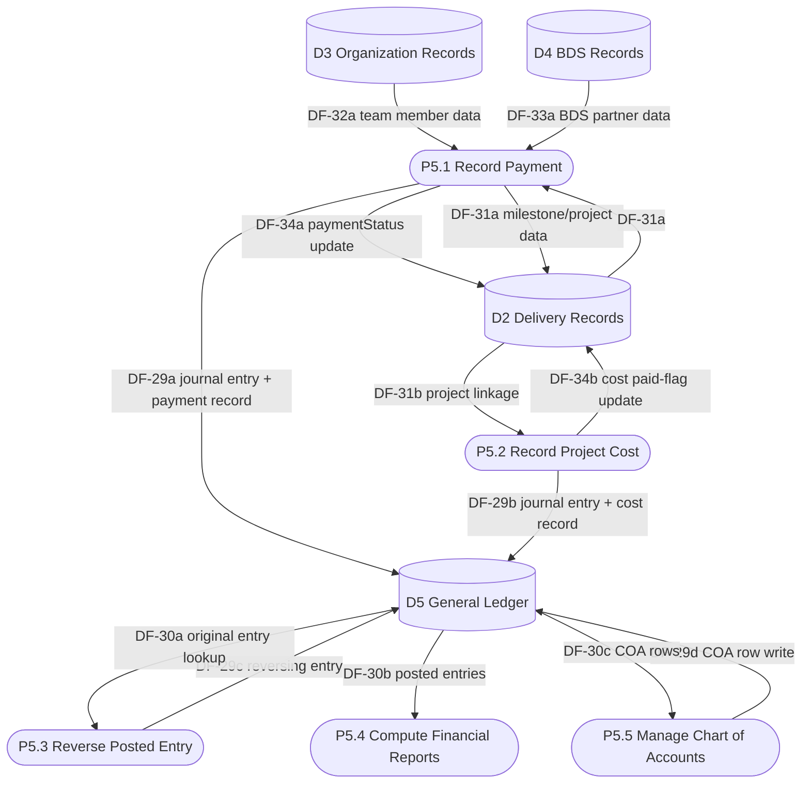

# Data Flow Architecture

## Small Company Management System ("hub")

| | |
|---|---|
| **Document title** | Small Company Management System — Data Flow Architecture |
| **Version** | 1.0 |
| **Date** | 2026-09-10 |
| **Author** | towfiq |
| **Based on** | SRS v1.0, DESIGN v1.0 |
| **Status** | Approved |

---

## 1. Introduction

### 1.1 Purpose

Logical decomposition of hub into processes, the data moving between them, and where that data rests. Logical, not physical — no servers/containers/regions/instances. Deployment shape is already decided (DEC-003/004/005: single Oracle VM, Docker Compose) and isn't re-litigated here.

### 1.2 System boundary

Inside the system: all 7 functional modules (CRM, Projects, Organization, BDS, Finance, Administration, Dashboard), one NestJS API, one PostgreSQL database, one Next.js PWA frontend — all self-hosted, single deployment unit. Outside the system: only the end user's browser. Per BRD/SRS constraints (all payments manual, no SMTP, no payment gateway, $0 recurring cost), hub has **zero third-party system integrations** in v1 — this is a closed system with exactly one external entity.

### 1.3 Notation and conventions

| Element | Shape | ID | Mermaid |
|---|---|---|---|
| Process | stadium (rounded) | `P1`, `P5.1` | `P1(["P1 Verb the noun"])` |
| Data store | cylinder | `D1` | `D1[("D1 Store")]` |
| External entity | rectangle | `EXT-01` | `EXT01["EXT-01 End User"]` |
| Data flow | labelled directed edge | `DF-01` | `P1 -->|"DF-01 data"| D1` |
| Async/queued flow | dashed edge | — (none in v1) | `P1 -.->|"DF-XX event"| P2` |
| Trust boundary | dashed subgraph | `TB-1` | `subgraph TB1["TB-1 name"]` |

## 2. Context diagram (level 0)

### 2.1 External entities

| ID | External entity | Kind | Traces to | Flows |
|---|---|---|---|---|
| EXT-01 | End User (browser) | user class (all 4) | SRS §2.3 (Super Admin, Finance-permissioned, Project/Sales-permissioned, Viewer) | DF-01, DF-02, DF-05, DF-06, DF-11, DF-12, DF-18, DF-19, DF-22, DF-23, DF-27, DF-28, DF-40 |

No other external entities exist — confirmed by SRS §2.4/§2.6 (no third-party integrations) and BRD §4.2 (no payment gateway, no bank integration). RBAC (which SRS §2.3 class a given user belongs to) is an internal authorization concern, not a DFD boundary distinction — all four classes share one interaction channel.

## 3. Level-1 decomposition

### 3.1 Process inventory

| ID | Process (verb phrase) | Responsibility (1 line) | Implements | Reads | Writes | Level-2? |
|---|---|---|---|---|---|---|
| P1 | Track Sales Pipeline | Clients, leads, opportunities, and conversion to project | FR-CRM-01..06 | D1, D4 | D1 | no → §4.2 |
| P2 | Deliver Projects | Projects, milestones, deliverables, assignments, dual status | FR-PROJ-01..08 | D2, D3, D8 | D2, D8 | no → §4.2 |
| P3 | Manage Organization | Teams, team members, memberships | FR-ORG-01..04 | D3 | D3 | no → §4.2 |
| P4 | Track BDS Partners | BDS partners, attribution, compensation | FR-BDS-01..04 | D2, D4 | D4 | no → §4.2 |
| P5 | Post & Report Finances | Chart of accounts, journal entries, payments, reports | FR-FIN-01..16 | D2, D3, D4, D5 | D2, D5 | **yes → §4.1** |
| P6 | Authenticate & Administer Access | Login, users, roles, permissions, audit view | FR-ADMIN-01..07 | D6, D7 | D6 | no → §4.2 |
| P7 | Summarize Operations | Dashboard aggregates across all modules | FR-DASH-01..03 | D1, D2, D3, D4, D5 | — (read-only) | no → §4.2 |

## 4. Level-2 decomposition

### 4.1 P5 — Post & Report Finances

Warrants decomposition: implements 16 FRs (≥4) and touches 4 data stores (≥2).

| ID | Sub-process | Implements | Parent flow in | Parent flow out |
|---|---|---|---|---|
| P5.1 | Record Payment (client/team/BDS, unified mechanic) | FR-FIN-02, 03, 04, 05, 06, 07, 16 | DF-27 (payment entry), DF-31, DF-32, DF-33 | DF-28, DF-29, DF-34 |
| P5.2 | Record Project Cost | FR-FIN-08 | DF-27 (cost entry), DF-31 | DF-28, DF-29, DF-34 |
| P5.3 | Reverse Posted Entry | FR-FIN-12 | DF-27 (reversal request), DF-30 | DF-28, DF-29 |
| P5.4 | Compute Financial Reports | FR-FIN-09, 10, 11, 14, 15 | DF-27 (report request), DF-30, DF-31, DF-32, DF-33 | DF-28 |
| P5.5 | Manage Chart of Accounts | FR-FIN-01, 13 | DF-27 (COA management) | DF-28, DF-29, DF-30 |

*Parent-flow reconciliation: level-1's DF-27 (EXT-01→P5) fans out to all 5 sub-processes by request kind; DF-28 (P5→EXT-01) fans in from all 5; DF-29 (P5→D5) is the union of P5.1/P5.2/P5.3/P5.5's writes; DF-30 (D5→P5) is the union of P5.3/P5.4/P5.5's reads; DF-31/32/33 (D2/D3/D4→P5) are read by P5.1/P5.2/P5.4 as needed; DF-34 (P5→D2) is the union of P5.1's paymentStatus update and P5.2's cost paid-flag update. No sub-flow introduces a boundary crossing absent from P5's level-1 row.*

### 4.2 Not warranted

| Process | Why level-1 is enough |
|---|---|
| P1 | 6 FRs but 2 stores, no trust boundary through it |
| P2 | 8 FRs but 3 stores (D2, D3 read-only, D8), no trust boundary through it — borderline but each store interaction is a single simple read/write, no distinct sub-flow logic worth separating |
| P3 | 4 FRs, 1 store |
| P4 | 4 FRs, 2 stores (D2 read-only, D4) |
| P6 | 7 FRs but 2 stores (D6, D7 read-only) — login + CRUD + audit-view are mechanically similar (all direct D6/D7 access), no distinct sub-flow logic |
| P7 | 3 FRs, read-only across 5 stores — pure aggregation, no distinct sub-flow logic |

## 5. Data stores

| ID | Store | Holds (SRS §4.1 entities) | Written by | Read by | Durability | Trust zone |
|---|---|---|---|---|---|---|
| D1 | CRM Records | Client, Lead, Opportunity | P1 | P1, P7 | durable | TB-2 |
| D2 | Delivery Records | Project, Milestone, Deliverable, ProjectAssignment | P2, P5 (paymentStatus/cost-paid fields only) | P2, P4, P5, P7 | durable | TB-2 |
| D3 | Organization Records | Team, TeamMember, TeamMembership | P3 | P2, P3, P5, P7 | durable | TB-2 |
| D4 | BDS Records | BDSPartner, BDSCompensation | P4 | P1, P4, P5, P7 | durable | TB-2 |
| D5 | General Ledger | Account (COA), JournalEntry, JournalLine, MilestonePayment, TeamMemberPayment, BDSPayment, ProjectCost | P5 | P5, P7 | durable, immutable-append (per FR-FIN-12) | TB-2 |
| D6 | Identity & Access | User, Role, Permission | P6 | P6 | durable | TB-2 |
| D7 | Audit Log | AuditLog | P1, P2, P3, P4, P5, P6 (fan-in: any sensitive write) | P6 | durable, append-only | TB-2 |
| D8 | Resource Store | Resource (attachments) | P2 | P2 | durable (file + metadata) | TB-2 |

D2 having two writers (P2 for work-side fields, P5 for payment-side fields) is deliberate — SRS §3.3 models `workStatus` and `paymentStatus` as genuinely independent machines owned by different processes, not a modeling error. D7's fan-in from 6 processes is the audit-interceptor pattern already planned in `task-breakdown.md` Phase 2 (a cross-cutting NestJS interceptor, not 6 separate hand-written write paths) — noted here, not re-decided.

## 6. Flow inventory

| ID | From | To | Data carried | Sync/Async | Trigger | Crosses | Traces to |
|---|---|---|---|---|---|---|---|
| DF-01 | EXT-01 | P6 | credentials / admin action input | sync | user action | TB-1→TB-2 | FR-ADMIN-01..04 |
| DF-02 | P6 | EXT-01 | session token / admin screens | sync | on DF-01 | TB-2→TB-1 | FR-ADMIN-02..04 |
| DF-03 | P6 | D6 | identity/access record | sync | user action | — | FR-ADMIN-02..04 |
| DF-04 | D6 | P6 | identity/access record | sync | query | — | FR-ADMIN-02..04 |
| DF-05 | EXT-01 | P1 | client/lead/opportunity input | sync | user action | TB-1→TB-2 | FR-CRM-01..06 |
| DF-06 | P1 | EXT-01 | CRM screens/confirmations | sync | on DF-05 | TB-2→TB-1 | FR-CRM-01..06 |
| DF-07 | P1 | D1 | CRM record | sync | user action | — | FR-CRM-01..06 |
| DF-08 | D1 | P1 | CRM record | sync | query | — | FR-CRM-01..06 |
| DF-09 | D4 | P1 | BDS partner data | sync | query | — | FR-CRM-04 |
| DF-10 | P1 | P2 | won-opportunity conversion payload | sync | opportunity marked Won | — | FR-CRM-05 |
| DF-11 | EXT-01 | P2 | project/milestone/deliverable input | sync | user action | TB-1→TB-2 | FR-PROJ-01..08 |
| DF-12 | P2 | EXT-01 | project screens/confirmations | sync | on DF-11 | TB-2→TB-1 | FR-PROJ-01..08 |
| DF-13 | P2 | D2 | delivery record | sync | user action | — | FR-PROJ-01..08 |
| DF-14 | D2 | P2 | delivery record | sync | query | — | FR-PROJ-01..08 |
| DF-15 | D3 | P2 | team member data | sync | query | — | FR-ORG-04 |
| DF-16 | P2 | D8 | attachment | sync | user action | — | FR-PROJ-06 |
| DF-17 | D8 | P2 | attachment | sync | query | — | FR-PROJ-06 |
| DF-18 | EXT-01 | P3 | team/member input | sync | user action | TB-1→TB-2 | FR-ORG-01..04 |
| DF-19 | P3 | EXT-01 | org screens/confirmations | sync | on DF-18 | TB-2→TB-1 | FR-ORG-01..04 |
| DF-20 | P3 | D3 | org record | sync | user action | — | FR-ORG-01..04 |
| DF-21 | D3 | P3 | org record | sync | query | — | FR-ORG-01..04 |
| DF-22 | EXT-01 | P4 | BDS partner input | sync | user action | TB-1→TB-2 | FR-BDS-01..04 |
| DF-23 | P4 | EXT-01 | BDS screens/confirmations | sync | on DF-22 | TB-2→TB-1 | FR-BDS-01..04 |
| DF-24 | P4 | D4 | BDS record | sync | user action | — | FR-BDS-01..04 |
| DF-25 | D4 | P4 | BDS record | sync | query | — | FR-BDS-01..04 |
| DF-26 | D2 | P4 | project contract value | sync | query | — | FR-BDS-03 |
| DF-27 | EXT-01 | P5 | payment/cost/reversal/report/COA input | sync | user action | TB-1→TB-2 | FR-FIN-01..16 |
| DF-28 | P5 | EXT-01 | finance screens/confirmations/reports | sync | on DF-27 | TB-2→TB-1 | FR-FIN-01..16 |
| DF-29 | P5 | D5 | journal entry + business record | sync | user action | — | FR-FIN-02, 04, 06, 07, 08, 12, 13 |
| DF-30 | D5 | P5 | posted journal entries / COA rows | sync | query | — | FR-FIN-09, 10, 11, 12, 14, 15 |
| DF-31 | D2 | P5 | milestone/project data | sync | query | — | FR-FIN-04, 05, 08 |
| DF-32 | D3 | P5 | team member data | sync | query | — | FR-FIN-06 |
| DF-33 | D4 | P5 | BDS partner data | sync | query | — | FR-FIN-07 |
| DF-34 | P5 | D2 | paymentStatus / cost paid-flag update | sync | on DF-29 (same transaction) | — | FR-FIN-05, 08 |
| DF-35 | D1 | P7 | CRM summary data | sync | query | — | FR-DASH-01..03 |
| DF-36 | D2 | P7 | delivery summary data | sync | query | — | FR-DASH-01..03 |
| DF-37 | D5 | P7 | financial summary data | sync | query | — | FR-DASH-01 |
| DF-38 | D3 | P7 | team payable context | sync | query | — | FR-DASH-03 |
| DF-39 | D4 | P7 | BDS payable context | sync | query | — | FR-DASH-03 |
| DF-40 | P7 | EXT-01 | dashboard view | sync | user action | TB-2→TB-1 | FR-DASH-01..03 |
| DF-41 | P1, P2, P3, P4, P5, P6 | D7 | audit event (actor + before/after) | sync | on any sensitive write | — | FR-ADMIN-06 |
| DF-42 | D7 | P6 | audit event | sync | query | — | FR-ADMIN-06 |

No async flows exist in v1 — every flow is synchronous request/response, consistent with a single monolithic NestJS API and no background job/queue requirement anywhere in the SRS.

## 7. Trust boundaries

| ID | Boundary | Separates | Crossing flows | Governed by | Control |
|---|---|---|---|---|---|
| TB-1/TB-2 | Public internet ↔ application trust zone | EXT-01 ↔ (P1..P7) | DF-01, DF-02, DF-05, DF-06, DF-11, DF-12, DF-18, DF-19, DF-22, DF-23, DF-27, DF-28, DF-40 | NFR-SEC-01 | HTTPS/TLS + JWT bearer token; DF-27/DF-28 (Finance) additionally gated per-action by the create/reverse-vs-view permission split (FR-ADMIN-05) |

Only one trust boundary exists — no internal segmentation (no multi-tenant partition, no third-party network). All data stores sit in TB-2.

## 8. Decisions this diagram provokes

| Candidate decision | Evidence from this document |
|---|---|
| No message queue / async infra needed | Every flow in §6 is sync; DEC-002's NestJS-monolith choice is confirmed sufficient, not just assumed |
| Single-tenant confirmed | All 8 stores are single-tenant with exactly one external-entity type (§2.1, §5) — no multi-tenancy ADR needed |
| REST-only API surface confirmed | EXT-01 needs full CRUD/read access across 8 stores through one channel (§5, §6) — matches DEC-002's REST choice, not GraphQL |
| Audit as a cross-cutting interceptor, not per-module code | D7's 6-process fan-in (§5) is exactly the shape a single NestJS interceptor handles; writing it 6 times per-module would be the wrong shape |

All four rows confirm decisions already locked in `CLAUDE.md`/`docs/adr/` rather than surfacing new ones — this DFD didn't uncover a genuinely new architectural fork. Nothing here is a new item for `/agentic-harness:adr` beyond what it will reverse-engineer from the existing repo anyway.

## 9. Balance & orphan check

- **Level balance:** P5's level-2 (§4.1) reconciles against its level-1 row: DF-27→(P5.1..P5.5 by request kind), DF-28←(P5.1..P5.5), DF-29←(P5.1,P5.2,P5.3,P5.5 writes), DF-30→(P5.3,P5.4,P5.5 reads), DF-31/32/33→(P5.1,P5.2,P5.4 reads), DF-34←(P5.1,P5.2 writes). 8/8 parent boundary flows reconciled, 0 unbalanced. No other process is decomposed (§4.2).
- **FRs with no process:** none — all 48 BRD/SRS FRs appear in a level-1 `Implements` column (§3.1) or a level-2 sub-process's (§4.1).
- **Processes citing no FR/NFR:** none — every P1..P7 and P5.1..P5.5 cites ≥1 FR.
- **Stores with no SRS §4.1 entity:** none. **SRS §4.1 entities in no store:** none — all 21 entities from SRS §4.1 (User, Role, Permission, Team, TeamMember, TeamMembership, Client, Lead, Opportunity, Project, ProjectAssignment, Milestone, Deliverable, BDSPartner, BDSCompensation, Account, JournalEntry, JournalLine, MilestonePayment, TeamMemberPayment, BDSPayment, ProjectCost, AuditLog, Resource) map into D1–D8.
- **External entities with no SRS trace:** none (EXT-01 traces to all 4 SRS §2.3 classes). **SRS §5 interfaces with no external entity:** SRS §5.2's API operations are all internal implementation of EXT-01's flows — no orphan.
- **Black holes / miracles:** none — every process with an input flow also has an output flow (§6); every store written is also read (§5).
- **Write-only / read-only stores not declared:** none undeclared — P7's read-only relationship to all 5 stores it touches is explicit in §3.1's Writes column ("—").
- **Illegal flows:** none — no external→external or store→store flows anywhere in §6.
- **Boundary-crossing flows with no governing NFR:** none — all 13 TB-1↔TB-2 crossings cite NFR-SEC-01 (§7).

## Assumptions & Constraints

- Single external-entity model (EXT-01 = all user classes) is a deliberate simplification — RBAC differentiation happens inside TB-2 (P6's permission checks on every flow), not at the DFD boundary.
- DF-41's multi-source row (P1..P6 → D7) is shorthand for "the audit interceptor is invoked by all 6 processes identically" — not 6 independent hand-rolled flows.
- No historical/point-in-time variants are modeled (e.g., Balance Sheet's as-of-today-only scoping, SRS §3.6 FR-FIN-14) — that's a business-rule detail, not a data-flow-shape difference.

## Open Items (TBD)

None — this document raised no new unresolved question; the two carried-forward BRD/SRS open items (replacement ADR for ADR-0011, Phase 0 finance mockup rework) are tracked there, not duplicated here.

---
*End of document — v1.0. Open items: none new.*
