# Features

## Small Company Management System ("hub")

| | |
|---|---|
| **Document title** | Small Company Management System — Features |
| **Version** | 1.0 |
| **Date** | 2026-09-10 |
| **Based on** | SRS v1.1, DFD v1.0, DESIGN v1.0, ERD v1.0 |
| **Status** | Approved |

---

## F-01: Company Dashboard
- **Description:** Financial summary, operational summary, and attention-items aggregation across all modules.
- **User value:** One glance answers "what needs my attention today."
- **Requirements:** FR-DASH-01, FR-DASH-02, FR-DASH-03
- **Dependencies:** F-02, F-04, F-07, F-08, F-24
- **Complexity:** M
- **Priority:** Must
- **Risk:** Low — pure read aggregation, but only correct once its dependencies (CRM/Projects/Finance) exist and are populated.
- **Open questions:** none
- **Proposed owning area:** P7

## F-02: Client Management
- **Description:** Client CRUD, status, search/filter/sort/pagination.
- **User value:** One place to track who hub does business with.
- **Requirements:** FR-CRM-01, FR-CRM-06
- **Dependencies:** none
- **Complexity:** S
- **Priority:** Must
- **Risk:** Low
- **Open questions:** none
- **Proposed owning area:** P1

## F-03: Lead Management
- **Description:** Lead CRUD with a server-enforced status flow (New → Contacted → Qualified → Converted/Lost).
- **User value:** Nothing falls through the cracks between "someone reached out" and "qualified prospect."
- **Requirements:** FR-CRM-02
- **Dependencies:** none
- **Complexity:** S
- **Priority:** Must
- **Risk:** Low
- **Open questions:** none
- **Proposed owning area:** P1

## F-04: Opportunity Management
- **Description:** Opportunity CRUD with stage progression (Qualified → Proposal Sent → Negotiation → Won/Lost).
- **User value:** Tracks a deal from qualified interest to close.
- **Requirements:** FR-CRM-03
- **Dependencies:** none
- **Complexity:** S
- **Priority:** Must
- **Risk:** Low
- **Open questions:** none
- **Proposed owning area:** P1

## F-05: BDS Attribution on Leads/Opportunities
- **Description:** Optional BDS-partner attribution on a Lead, carried forward automatically to its Opportunity on conversion.
- **User value:** Credits the right external partner without manual re-entry.
- **Requirements:** FR-CRM-04
- **Dependencies:** F-03, F-04, F-16
- **Complexity:** S
- **Priority:** Should
- **Risk:** Low
- **Open questions:** none
- **Proposed owning area:** P1

## F-06: Opportunity → Project Conversion
- **Description:** Won-opportunity conversion: auto-creates a Client if none matches, creates a Project pre-filled with commercial data, carries BDS attribution forward, preserves the Opportunity↔Project lineage.
- **User value:** Turning a won deal into active work is one action, not five.
- **Requirements:** FR-CRM-05
- **Dependencies:** F-02, F-04, F-07
- **Complexity:** M
- **Priority:** Must
- **Risk:** Medium — spans two owning processes (P1 creates the Client/triggers, P2 creates the Project); needs a real transaction across both, not two independent unguarded writes.
- **Open questions:** none
- **Proposed owning area:** P1 (primary), P2 (receiving)

## F-07: Project Management
- **Description:** Project CRUD (auto-coded), status lifecycle, project overview aggregation.
- **User value:** The primary operational record for a piece of client work.
- **Requirements:** FR-PROJ-01, FR-PROJ-02
- **Dependencies:** F-02
- **Complexity:** M
- **Priority:** Must
- **Risk:** Low
- **Open questions:** none
- **Proposed owning area:** P2

## F-08: Milestone Management
- **Description:** Ordered, reorderable milestones per project; independent work-status and payment-status machines (payment never blocks the next milestone); overdue derived at read time.
- **User value:** The core billing/progression unit, and the guarantee that unpaid invoices never stall delivery.
- **Requirements:** FR-PROJ-03, FR-PROJ-04, FR-PROJ-05
- **Dependencies:** F-07
- **Complexity:** M
- **Priority:** Must
- **Risk:** Medium — the dual-status-machine independence is a core business invariant (BRD §2.3/§2.4); easy to accidentally couple the two machines during implementation.
- **Open questions:** none
- **Proposed owning area:** P2

## F-09: Deliverable Management
- **Description:** Deliverable CRUD per milestone with submit/review/approve/reject flow and attachments.
- **User value:** Concrete, trackable outputs tied to each milestone.
- **Requirements:** FR-PROJ-06
- **Dependencies:** F-08
- **Complexity:** M
- **Priority:** Must
- **Risk:** Low
- **Open questions:** none
- **Proposed owning area:** P2

## F-10: Milestone Completion Gating
- **Description:** A milestone completes only when all required deliverables are approved, unless an authorized user overrides with a required reason (separate `milestones.complete_override` permission).
- **User value:** Quality gate on delivery, with an escape hatch for real business exceptions.
- **Requirements:** FR-PROJ-07
- **Dependencies:** F-09
- **Complexity:** M
- **Priority:** Must
- **Risk:** Low
- **Open questions:** none
- **Proposed owning area:** P2

## F-11: Project/Milestone Search & Filtering
- **Description:** Search, filter (status/client/date range), sort, pagination on project and milestone lists.
- **User value:** Finds the right project/milestone quickly as the list grows.
- **Requirements:** FR-PROJ-08
- **Dependencies:** F-07, F-08
- **Complexity:** S
- **Priority:** Should
- **Risk:** Low
- **Open questions:** none
- **Proposed owning area:** P2

## F-12: Team Management
- **Description:** Team CRUD, restricted to `teams.*` permission holders.
- **User value:** Organizational grouping for internal staff.
- **Requirements:** FR-ORG-01
- **Dependencies:** none
- **Complexity:** S
- **Priority:** Must
- **Risk:** Low
- **Open questions:** none
- **Proposed owning area:** P3

## F-13: Team Member Management
- **Description:** Team Member CRUD with one required primary team plus optional secondary team memberships.
- **User value:** Tracks internal people and their organizational placement.
- **Requirements:** FR-ORG-02, FR-ORG-03
- **Dependencies:** F-12
- **Complexity:** S
- **Priority:** Must
- **Risk:** Low
- **Open questions:** none
- **Proposed owning area:** P3

## F-14: Project Assignment
- **Description:** Assign team members to projects (many-to-many, start/end dates), no project-specific role field.
- **User value:** Answers "who's on this project" and "what is this person working on" both directions.
- **Requirements:** FR-ORG-04
- **Dependencies:** F-13, F-07
- **Complexity:** S
- **Priority:** Must
- **Risk:** Low
- **Open questions:** none
- **Proposed owning area:** P3

## F-15: BDS Partner Management
- **Description:** BDS Partner CRUD, modeled as a distinct external-party entity from TeamMember.
- **User value:** Tracks external business-development contributors.
- **Requirements:** FR-BDS-01
- **Dependencies:** none
- **Complexity:** S
- **Priority:** Must
- **Risk:** Low
- **Open questions:** none
- **Proposed owning area:** P4

## F-16: BDS Compensation & Partner Detail
- **Description:** Fixed-or-percentage compensation per project (locked after first payment), attribution carry-forward through conversion, partner detail rollup (attributed projects, total value, payment history).
- **User value:** Correctly tracks what's owed to an external partner and what's already been paid.
- **Requirements:** FR-BDS-02, FR-BDS-03, FR-BDS-04
- **Dependencies:** F-15, F-07
- **Complexity:** M
- **Priority:** Must
- **Risk:** Medium — the fixed/percentage lock-after-first-payment rule needs the payment feature (F-19-F-21 family) to actually enforce the lock at the right moment.
- **Open questions:** none
- **Proposed owning area:** P4

## F-17: Chart of Accounts Management
- **Description:** Flat chart of accounts (Asset/Liability/Equity/Revenue/Expense), money-holding accounts as a filtered Asset subset; admin add/deactivate of accounts and categories.
- **User value:** The structural foundation every financial posting depends on.
- **Requirements:** FR-FIN-01, FR-FIN-13
- **Dependencies:** none
- **Complexity:** M
- **Priority:** Must
- **Risk:** Low — small, well-specified seed data; real risk is downstream (features that post against it), not here.
- **Open questions:** none
- **Proposed owning area:** P5.5

## F-18: Client Milestone Payment Posting
- **Description:** Manual client/milestone payment entry; atomically creates the payment record and a balanced 2-line journal entry (Debit money account, Credit Revenue); recomputes milestone/project received-due-not-yet-due.
- **User value:** The core revenue-recognition action of the whole system.
- **Requirements:** FR-FIN-04, FR-FIN-05, FR-FIN-16 (also exercises FR-FIN-02, FR-FIN-03's posting/balance mechanics)
- **Dependencies:** F-08, F-17
- **Complexity:** L
- **Priority:** Must
- **Risk:** High — the single most safety-critical write path (money + atomicity + status recompute in one transaction); any bug here corrupts the ledger's core invariant.
- **Open questions:** none
- **Proposed owning area:** P5.1

## F-19: Team Member Payment Posting
- **Description:** Manual team-member payment entry; atomically posts a balanced journal entry and updates payable/project-cost linkage.
- **User value:** Pays internal staff with a full audit/ledger trail.
- **Requirements:** FR-FIN-06, FR-FIN-16
- **Dependencies:** F-13, F-17
- **Complexity:** M
- **Priority:** Must
- **Risk:** Medium — same atomicity pattern as F-18, smaller surface.
- **Open questions:** none
- **Proposed owning area:** P5.1

## F-20: BDS Payment Posting
- **Description:** Manual BDS-partner payment entry; atomically posts a balanced journal entry and updates BDS outstanding/project-cost linkage.
- **User value:** Pays external partners with the same rigor as internal payments.
- **Requirements:** FR-FIN-07, FR-FIN-16
- **Dependencies:** F-16, F-17
- **Complexity:** M
- **Priority:** Must
- **Risk:** Medium — same atomicity pattern as F-18/F-19, plus the compensation-lock interaction with F-16.
- **Open questions:** none
- **Proposed owning area:** P5.1

## F-21: Project Cost Recording
- **Description:** Record a project cost as paid (posts a journal entry immediately) or unpaid (becomes a computed payable until later paid).
- **User value:** Tracks non-payment project spend against profitability.
- **Requirements:** FR-FIN-08
- **Dependencies:** F-07, F-17
- **Complexity:** M
- **Priority:** Must
- **Risk:** Low
- **Open questions:** none
- **Proposed owning area:** P5.2

## F-22: Journal Entry Reversal
- **Description:** Correct a posted journal entry only via a linked reversing entry (flipped debit/credit lines) — no update/delete path ever exists.
- **User value:** Fixes mistakes without ever breaking the audit trail.
- **Requirements:** FR-FIN-12
- **Dependencies:** F-18, F-19, F-20, F-21
- **Complexity:** M
- **Priority:** Must
- **Risk:** Medium — must correctly unwind every side-effect the original posting caused (milestone paymentStatus, cost paidStatus), not just the ledger lines.
- **Open questions:** none
- **Proposed owning area:** P5.3

## F-23: Receivables & Payables Engine
- **Description:** Computed receivables (received/currently due/not-yet-due/overdue) and payables (team/BDS/other), derived from milestone amounts, cost records, and posted payments — never ledger-tracked AR/AP accounts.
- **User value:** Answers "what's owed to us" and "what do we owe" without manual reconciliation.
- **Requirements:** FR-FIN-09, FR-FIN-10
- **Dependencies:** F-18, F-19, F-20, F-21
- **Complexity:** M
- **Priority:** Must
- **Risk:** Low — pure computation, but must stay exactly consistent with the cash-basis model (SRS §3.6) — no accidental AR/AP account leakage.
- **Open questions:** none
- **Proposed owning area:** P5.4

## F-24: Project Financial Summary
- **Description:** Per-project contract value, receivables breakdown, cost paid/unpaid/total, expected gross profit.
- **User value:** One view of whether a specific project is profitable.
- **Requirements:** FR-FIN-11
- **Dependencies:** F-23
- **Complexity:** S
- **Priority:** Must
- **Risk:** Low
- **Open questions:** none
- **Proposed owning area:** P5.4

## F-25: Financial Statements (Trial Balance / P&L / Balance Sheet)
- **Description:** Computed directly from posted journal lines — Trial Balance and P&L always balance to zero by construction; Balance Sheet uses a distinct equity formula folding in Receivables/Payables, as-of-today only.
- **User value:** Real accounting-grade reporting the stakeholder specifically asked for (DEC-068/069/070's driving motivation).
- **Requirements:** FR-FIN-14
- **Dependencies:** F-17, F-18, F-19, F-20, F-21, F-23
- **Complexity:** L
- **Priority:** Must
- **Risk:** High — the Balance Sheet's `Equity_BS = Equity_TB + AR − AP` identity is exactly the kind of formula ADR-0011's own history (Balance Sheet algebra bug, caught by hub-solution-architect) shows is easy to get subtly wrong; needs the same independent algebraic verification this repo already learned to do once.
- **Open questions:** none
- **Proposed owning area:** P5.4

## F-26: Financial List Filtering
- **Description:** Filter journal entries/payments by date range, account, category, project, client, team member, BDS partner, direction, payment status.
- **User value:** Finds a specific financial record quickly as volume grows.
- **Requirements:** FR-FIN-15
- **Dependencies:** F-18, F-19, F-20
- **Complexity:** S
- **Priority:** Should
- **Risk:** Low
- **Open questions:** none
- **Proposed owning area:** P5.4

## F-27: Authentication
- **Description:** Login, JWT access(1d)/refresh(7d), argon2id hashing, lockout after 10 failed attempts/15min.
- **User value:** Secure entry point; everything else requires this to exist first.
- **Requirements:** FR-ADMIN-02
- **Dependencies:** none
- **Complexity:** M
- **Priority:** Must
- **Risk:** Medium — standard pattern, but security-sensitive; token lifetime/lockout values are already locked (DEC-012), reducing design risk.
- **Open questions:** none
- **Proposed owning area:** P6

## F-28: User Management
- **Description:** User CRUD, activate/deactivate, admin-mediated password reset (no SMTP dependency).
- **User value:** Onboards and offboards people from the system.
- **Requirements:** FR-ADMIN-02
- **Dependencies:** F-27
- **Complexity:** M
- **Priority:** Must
- **Risk:** Low
- **Open questions:** none
- **Proposed owning area:** P6

## F-29: Role & Permission Management (RBAC)
- **Description:** Role CRUD as named permission bundles; granular action-based permission catalog; effective access is the allow-only union of active roles; sensitive finance actions separately permissioned from view.
- **User value:** Fine-grained, auditable access control matching who should actually be able to do what.
- **Requirements:** FR-ADMIN-03, FR-ADMIN-04, FR-ADMIN-05
- **Dependencies:** F-28
- **Complexity:** L
- **Priority:** Must
- **Risk:** Medium — every other feature's write paths depend on this being correct; a permission-model bug is a security bug, not just a UX one.
- **Open questions:** none
- **Proposed owning area:** P6

## F-30: Super Admin Invariant Enforcement
- **Description:** A deactivation/role-removal request that would leave zero active Super Admins is rejected server-side (422), not merely discouraged in the UI.
- **User value:** The system can never accidentally lock everyone out.
- **Requirements:** FR-ADMIN-01
- **Dependencies:** F-29
- **Complexity:** S
- **Priority:** Must
- **Risk:** Low — small logic, but a genuine invariant worth its own explicit feature/test rather than folding silently into F-28/F-29.
- **Open questions:** none
- **Proposed owning area:** P6

## F-31: Audit Logging
- **Description:** Every sensitive write (across all modules) emits an AuditLog row (actor, before/after, timestamp) via a shared interceptor; an audit log screen to view it.
- **User value:** Full accountability trail for every operational and financial action.
- **Requirements:** FR-ADMIN-06
- **Dependencies:** F-29
- **Complexity:** M
- **Priority:** Must
- **Risk:** Medium — cross-cutting (DFD D7's 6-process fan-in); must ship as shared infrastructure before/alongside other write features, not bolted on per-module afterward.
- **Open questions:** none
- **Proposed owning area:** P6

## F-32: System Settings
- **Description:** Admin-configurable options screen (chart-of-accounts management surface lives here per F-17, system-wide preferences).
- **User value:** One place for administrative configuration.
- **Requirements:** FR-ADMIN-07
- **Dependencies:** F-17, F-29
- **Complexity:** S
- **Priority:** Should
- **Risk:** Low
- **Open questions:** none
- **Proposed owning area:** P6

## Dependency graph

```mermaid
graph TD
  F27["F-27 Authentication"] --> F28["F-28 User Mgmt"]
  F28 --> F29["F-29 RBAC"]
  F29 --> F30["F-30 Super Admin Invariant"]
  F29 --> F31["F-31 Audit Logging"]

  F02["F-02 Client Mgmt"] --> F07["F-07 Project Mgmt"]
  F02 --> F06["F-06 Opp→Project Conversion"]
  F04["F-04 Opportunity Mgmt"] --> F06
  F07 --> F06
  F03["F-03 Lead Mgmt"] --> F05["F-05 BDS Attribution"]
  F04 --> F05
  F15["F-15 BDS Partner Mgmt"] --> F05
  F15 --> F16["F-16 BDS Compensation"]
  F07 --> F16

  F07 --> F08["F-08 Milestone Mgmt"]
  F08 --> F09["F-09 Deliverable Mgmt"]
  F09 --> F10["F-10 Completion Gating"]
  F07 --> F11["F-11 Proj/Milestone Search"]
  F08 --> F11

  F12["F-12 Team Mgmt"] --> F13["F-13 Team Member Mgmt"]
  F13 --> F14["F-14 Project Assignment"]
  F07 --> F14

  F17["F-17 Chart of Accounts"] --> F18["F-18 Client Milestone Payment"]
  F08 --> F18
  F17 --> F19["F-19 Team Payment"]
  F13 --> F19
  F17 --> F20["F-20 BDS Payment"]
  F16 --> F20
  F17 --> F21["F-21 Project Cost"]
  F07 --> F21

  F18 --> F22["F-22 Reversal"]
  F19 --> F22
  F20 --> F22
  F21 --> F22

  F18 --> F23["F-23 Receivables/Payables"]
  F19 --> F23
  F20 --> F23
  F21 --> F23
  F23 --> F24["F-24 Project Financial Summary"]
  F23 --> F25["F-25 Financial Statements"]
  F17 --> F25
  F18 --> F26["F-26 Financial Filtering"]
  F19 --> F26
  F20 --> F26

  F17 --> F32["F-32 System Settings"]
  F29 --> F32

  F02 --> F01["F-01 Company Dashboard"]
  F04 --> F01
  F07 --> F01
  F08 --> F01
  F23 --> F01
```

*Excluded from the graph for readability, per `planning-protocol.md`'s intent: the universal "every write-capable feature depends on F-27/F-29/F-31 being live" relationship — auth, RBAC, and audit logging are foundational infrastructure that ships first/alongside everything else, not a per-feature dependency edge repeated 25 times. See Assumptions below.*

## MVP cut

### Phase 1 (MVP) — all Must-priority features
F-01, F-02, F-03, F-04, F-06, F-07, F-08, F-09, F-10, F-12, F-13, F-14, F-15, F-16, F-17, F-18, F-19, F-20, F-21, F-22, F-23, F-24, F-25, F-27, F-28, F-29, F-30, F-31

### Later phases — Should-priority, deferrable without breaking BRD's MVP definition
F-05 (BDS attribution on Lead/Opportunity — already-created leads/opportunities work without it, attribution can be added once compensation tracking (F-16, Must) is live), F-11 (project/milestone search/filter — lists work unfiltered first), F-26 (financial list filtering — same reasoning), F-32 (system settings — chart of accounts can ship with seed-only data initially, admin UI as a fast-follow)

No Won't-this-round features exist — BRD's Out-of-scope list (§4.2) already excludes everything that would otherwise land here; nothing in-scope was deferred beyond Should→later-phase.

## Orphan check

- **FRs with no feature:** none — all 48 SRS FRs are cited by ≥1 feature.
- **Features with no FR/NFR:** none — every F-01..F-32 cites ≥1 FR.
- **DFD processes with no owning feature:** none — P1 (F-02..F-06), P2 (F-07..F-11), P3 (F-12..F-14), P4 (F-15, F-16), P5.1..P5.5 (F-17..F-26), P6 (F-27..F-32), P7 (F-01) — every level-1 and level-2 DFD process owns ≥1 feature.
- **Features with no resolvable DFD process:** none — every feature's Proposed owning area is a real DFD §3.1/§4.1 process ID.

## Assumptions & Constraints

- Auth (F-27), RBAC (F-29), and Audit Logging (F-31) are treated as foundational infrastructure every other write-capable feature implicitly requires — not drawn as individual dependency edges to avoid a 25-edge graph that obscures the real business-data dependencies.
- Feature sizing (S/M/L/XL) is rough relative sizing for sequencing, not an hours estimate — actual estimation is `/agentic-harness:epics`' job.
- FR-FIN-02/03 (balanced-posting enforcement, balance-always-computed) are cross-cutting mechanics threaded through every Finance posting feature (F-18-F-22, F-25) rather than a standalone feature — cited in F-18's Requirements line as the representative anchor.

## Open Items (TBD)

None — this stage raised no new unresolved question; SRS Appendix B's carried-forward items (replacement ADR for ADR-0011, Phase 0 finance mockup rework) remain tracked there.

---
*End of document — v1.0. Open items: none new.*
