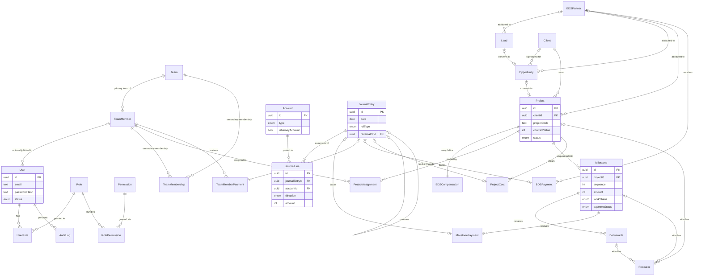

# Data Model

## Small Company Management System ("hub")

| | |
|---|---|
| **Document title** | Small Company Management System — Data Model |
| **Version** | 0.1 (Draft) |
| **Date** | 2026-09-10 |
| **Author** | towfiq |
| **Based on** | SRS v1.0, DFD v1.0 |
| **Status** | For review |

---

## 1. Introduction

### 1.1 Purpose and altitude

The **logical** data model underneath SRS §4's summary: full attributes, keys, cardinality, normalization stance, access patterns, lifecycle. Logical only — no Postgres-specific DDL, index plan, or partitioning; those follow the (already-locked) Prisma/PostgreSQL decision, which this document feeds, not the other way round.

### 1.2 Type vocabulary

`uuid`, `text`, `int` (poisha for all money fields — BRD NFR-01/CLAUDE.md rule 1, never `decimal`/float), `date`, `bool`, `timestamptz`, `json`, `enum<...>`, `bytes` (not used in v1 — files live outside the DB per `Resource.fileUrl`).

### 1.3 Key and naming conventions

Surrogate `uuid` PK on every entity except two pure join tables (composite natural PK) and `Permission` (natural PK — its `key` string, e.g. `clients.view`, *is* the identity; it's a fixed catalog defined in `packages/shared`, not a row a user creates). Singular entity names. `createdAt`/`updatedAt` timestamps on every mutable entity; `createdBy`/`updatedBy` (FK → User) wherever SRS names an actor field. No soft-delete flag anywhere — see §1.4/§4's delete convention: archival happens through each entity's own `status` enum, never a `deletedAt` column.

### 1.4 Delete convention (decided this session, applies model-wide)

**RESTRICT everywhere; archive via `status` instead of deletion.** No FK cascades a hard delete through business or financial history. Client/Lead/Opportunity/Project/TeamMember/BDSPartner/Account already carry a `status` enum (`Active`/`Inactive`/`Archived`) — that's how a record stops being active, never a DB-level cascade. A genuinely empty, never-referenced row (e.g. a `Pending` Milestone with zero Deliverables/Payments) may still be hard-deleted by application logic per SRS §3.3's business rule, but the FK itself is always `RESTRICT`, never `CASCADE`. Ledger rows (`JournalEntry`, `JournalLine`, and the four payment/cost record types) are never deleted at all, by any path — correction is exclusively the linked-reversal mechanism (SRS FR-FIN-12).

### 1.5 Tenancy stance

Single-tenant. No tenant discriminator on any entity — confirmed by BRD §8 and DFD §1.2/§2.1 (exactly one external-entity type, no multi-company/multi-org concept anywhere in scope).

## 2. Entity overview

Crow's-foot key: `||--o{` one-to-zero-or-many · `||--|{` one-to-one-or-many · `|o--o{` zero-or-one-to-zero-or-many · `|o--o|` zero-or-one-to-zero-or-one · `||--||` one-to-one.

## 3. Entities in detail

### 3.1 User
**Purpose:** authenticated principal. **Tenancy:** n/a (single-tenant). **Traces to:** FR-ADMIN-01, 02 · **SRS §4.1:** User · **DFD store:** D6

| Attribute | Type | Key | Null | Constraint / default | Notes |
|---|---|---|---|---|---|
| id | uuid | PK | no | gen | |
| email | text | — | no | unique | login identity |
| passwordHash | text | — | no | argon2id | |
| name | text | — | no | | |
| teamMemberId | uuid | FK → TeamMember.id | yes | RESTRICT | not every user is a team member (SRS §2.3) |
| status | enum<Active,Inactive> | — | no | `Active` | |
| lastLoginAt | timestamptz | — | yes | | |
| createdAt / updatedAt | timestamptz | — | no | now() | |

*Invariant: ≥1 User with an active `SUPER_ADMIN` role must exist at all times (FR-ADMIN-01) — enforced in application logic, not expressible as a single-row constraint.*

### 3.2 Role
**Purpose:** named permission bundle. **Traces to:** FR-ADMIN-03 · **SRS §4.1:** Role · **DFD store:** D6

| Attribute | Type | Key | Null | Constraint / default | Notes |
|---|---|---|---|---|---|
| id | uuid | PK | no | gen | |
| name | text | — | no | unique | e.g. `SUPER_ADMIN` (fixed, non-deletable), or admin-defined |
| description | text | — | yes | | |
| status | enum<Active,Inactive> | — | no | `Active` | |
| createdAt / updatedAt | timestamptz | — | no | now() | |

### 3.3 Permission
**Purpose:** fixed, code-defined action catalog. **Traces to:** FR-ADMIN-04 · **SRS §4.1:** Permission · **DFD store:** D6

| Attribute | Type | Key | Null | Constraint / default | Notes |
|---|---|---|---|---|---|
| key | text | PK (natural) | no | format `resource.action` | defined in `packages/shared`, not user-created |
| label | text | — | no | | |
| category | text | — | no | | module grouping for the permission-matrix UI |

### 3.4 UserRole (join)
**Purpose:** many-to-many User↔Role. **Traces to:** FR-ADMIN-04

| Attribute | Type | Key | Null | Constraint / default | Notes |
|---|---|---|---|---|---|
| userId | uuid | PK, FK → User.id | no | RESTRICT | |
| roleId | uuid | PK, FK → Role.id | no | RESTRICT | |
| assignedAt | timestamptz | — | no | now() | |

### 3.5 RolePermission (join)
**Purpose:** many-to-many Role↔Permission. **Traces to:** FR-ADMIN-04

| Attribute | Type | Key | Null | Constraint / default | Notes |
|---|---|---|---|---|---|
| roleId | uuid | PK, FK → Role.id | no | RESTRICT | |
| permissionKey | text | PK, FK → Permission.key | no | RESTRICT | |

### 3.6 Team
**Purpose:** organizational grouping. **Traces to:** FR-ORG-01 · **SRS §4.1:** Team · **DFD store:** D3

| Attribute | Type | Key | Null | Constraint / default | Notes |
|---|---|---|---|---|---|
| id | uuid | PK | no | gen | |
| name | text | — | no | unique | |
| description | text | — | yes | | |
| teamLeadId | uuid | FK → TeamMember.id | yes | RESTRICT | |
| status | enum<Active,Inactive> | — | no | `Active` | |
| createdBy | uuid | FK → User.id | no | RESTRICT | |
| createdAt / updatedAt | timestamptz | — | no | now() | |

### 3.7 TeamMember
**Purpose:** internal person. **Traces to:** FR-ORG-02, 03 · **SRS §4.1:** TeamMember · **DFD store:** D3

| Attribute | Type | Key | Null | Constraint / default | Notes |
|---|---|---|---|---|---|
| id | uuid | PK | no | gen | |
| name | text | — | no | | |
| contact | text | — | yes | | |
| primaryTeamId | uuid | FK → Team.id | no | RESTRICT | exactly one primary team (decided at SRS stage) |
| organizationRole | text | — | yes | | e.g. Developer, Designer — label only |
| status | enum<Active,Inactive,Archived> | — | no | `Active` | |
| joinedAt | date | — | no | | |
| notes | text | — | yes | | |
| createdBy | uuid | FK → User.id | no | RESTRICT | |
| createdAt / updatedAt | timestamptz | — | no | now() | |

### 3.8 TeamMembership (join)
**Purpose:** optional *secondary* team memberships (primary team is `TeamMember.primaryTeamId` directly). **Traces to:** FR-ORG-03

| Attribute | Type | Key | Null | Constraint / default | Notes |
|---|---|---|---|---|---|
| teamMemberId | uuid | PK, FK → TeamMember.id | no | RESTRICT | |
| teamId | uuid | PK, FK → Team.id | no | RESTRICT | must differ from `primaryTeamId` — app-level check |

### 3.9 Client
**Purpose:** a company/person hub does business with. **Traces to:** FR-CRM-01 · **SRS §4.1:** Client · **DFD store:** D1

| Attribute | Type | Key | Null | Constraint / default | Notes |
|---|---|---|---|---|---|
| id | uuid | PK | no | gen | |
| name | text | — | no | | |
| companyName | text | — | yes | | |
| phone / email / address | text | — | yes | | |
| notes | text | — | yes | | |
| status | enum<Active,Inactive,Archived> | — | no | `Active` | |
| createdBy | uuid | FK → User.id | no | RESTRICT | |
| createdAt | timestamptz | — | no | now() | |
| updatedBy | uuid | FK → User.id | yes | RESTRICT | |
| updatedAt | timestamptz | — | no | now() | |

### 3.10 Lead
**Purpose:** early-stage sales contact. **Traces to:** FR-CRM-02, 04 · **SRS §4.1:** Lead · **DFD store:** D1

| Attribute | Type | Key | Null | Constraint / default | Notes |
|---|---|---|---|---|---|
| id | uuid | PK | no | gen | |
| name / company / contactInfo | text | — | mixed | name required | |
| source | text | — | yes | | |
| assignedUserId | uuid | FK → User.id | yes | RESTRICT | |
| bdsPartnerId | uuid | FK → BDSPartner.id | yes | RESTRICT | optional attribution |
| status | enum<New,Contacted,Qualified,Converted,Lost> | — | no | `New` | server-enforced transitions (SRS §3.2) |
| notes | text | — | yes | | |
| createdBy | uuid | FK → User.id | no | RESTRICT | |
| createdAt / updatedAt | timestamptz | — | no | now() | |

### 3.11 Opportunity
**Purpose:** qualified prospect pursued toward becoming a Project. **Traces to:** FR-CRM-03, 04, 05 · **SRS §4.1:** Opportunity · **DFD store:** D1

| Attribute | Type | Key | Null | Constraint / default | Notes |
|---|---|---|---|---|---|
| id | uuid | PK | no | gen | |
| sourceLeadId | uuid | FK → Lead.id | yes | RESTRICT | set if this Opportunity came from a converted Lead |
| clientId | uuid | FK → Client.id | yes | RESTRICT | may be a not-yet-a-client prospect |
| title | text | — | no | | |
| estimatedValue | int | — | no | poisha | |
| expectedCloseDate | date | — | yes | | |
| assignedUserId | uuid | FK → User.id | yes | RESTRICT | |
| bdsPartnerId | uuid | FK → BDSPartner.id | yes | RESTRICT | copied from `Lead.bdsPartnerId` on conversion, independently editable after |
| stage | enum<Qualified,ProposalSent,Negotiation,Won,Lost> | — | no | `Qualified` | |
| notes | text | — | yes | | |
| createdAt / updatedAt | timestamptz | — | no | now() | |

### 3.12 Project
**Purpose:** primary delivery unit. **Traces to:** FR-PROJ-01, FR-CRM-05, FR-BDS-02 · **SRS §4.1:** Project · **DFD store:** D2

| Attribute | Type | Key | Null | Constraint / default | Notes |
|---|---|---|---|---|---|
| id | uuid | PK | no | gen | |
| projectCode | text | — | no | unique, `PRJ-YYYY-###` | |
| name | text | — | no | | |
| clientId | uuid | FK → Client.id | no | RESTRICT | |
| description | text | — | yes | | |
| ownerId | uuid | FK → User.id | yes | RESTRICT | |
| startDate / expectedEndDate / actualEndDate | date | — | mixed | start required | |
| status | enum<Draft,Planning,Active,OnHold,Completed,Cancelled> | — | no | `Draft` | |
| contractValue | int | — | no | poisha | |
| bdsPartnerId | uuid | FK → BDSPartner.id | yes | RESTRICT | |
| originOpportunityId | uuid | FK → Opportunity.id | yes | RESTRICT, unique | preserves conversion lineage (FR-CRM-05) |
| createdBy | uuid | FK → User.id | no | RESTRICT | |
| createdAt | timestamptz | — | no | now() | |
| updatedBy | uuid | FK → User.id | yes | RESTRICT | |
| updatedAt | timestamptz | — | no | now() | |

### 3.13 ProjectAssignment
**Purpose:** TeamMember↔Project staffing, no project-role field. **Traces to:** FR-ORG-04 · **SRS §4.1:** ProjectAssignment · **DFD store:** D2

| Attribute | Type | Key | Null | Constraint / default | Notes |
|---|---|---|---|---|---|
| id | uuid | PK | no | gen | |
| teamMemberId | uuid | FK → TeamMember.id | no | RESTRICT | |
| projectId | uuid | FK → Project.id | no | RESTRICT | |
| startDate | date | — | no | | |
| endDate | date | — | yes | | |
| status | enum<Active,Ended> | — | no | `Active` | |
| notes | text | — | yes | | |

### 3.14 Milestone
**Purpose:** sequenced delivery + billing unit. **Traces to:** FR-PROJ-03, 04, 05, 07 · **SRS §4.1/§4.4:** Milestone · **DFD store:** D2

| Attribute | Type | Key | Null | Constraint / default | Notes |
|---|---|---|---|---|---|
| id | uuid | PK | no | gen | |
| projectId | uuid | FK → Project.id | no | RESTRICT | |
| name / description | text | — | mixed | name required | |
| sequence | int | — | no | unique per `projectId` | reorderable (SRS FR-PROJ-03) |
| startDate / dueDate / completionDate | date | — | yes | | |
| amount | int | — | no | poisha | |
| paymentDueDate | date | — | yes | | |
| workStatus | enum<Pending,InProgress,Completed,OnHold,Cancelled> | — | no | `Pending` | SRS §4.4 |
| paymentStatus | enum<NotDue,Pending,PartiallyPaid,Paid> | — | no | `NotDue` | written by P5 (Finance) on payment posting — SRS DFD §5 |
| createdBy | uuid | FK → User.id | no | RESTRICT | |
| createdAt | timestamptz | — | no | now() | |
| updatedBy | uuid | FK → User.id | yes | RESTRICT | |
| updatedAt | timestamptz | — | no | now() | |

*`Overdue` is never a column — always `paymentStatus IN (Pending,PartiallyPaid) AND paymentDueDate < today`, computed at read time (FR-PROJ-05).*

### 3.15 Deliverable
**Purpose:** concrete output gating milestone completion. **Traces to:** FR-PROJ-06, 07 · **SRS §4.1:** Deliverable · **DFD store:** D2

| Attribute | Type | Key | Null | Constraint / default | Notes |
|---|---|---|---|---|---|
| id | uuid | PK | no | gen | |
| milestoneId | uuid | FK → Milestone.id | no | RESTRICT | |
| name / description | text | — | mixed | name required | |
| dueDate | date | — | yes | | |
| status | enum<Pending,InProgress,Submitted,UnderReview,Approved,Rejected> | — | no | `Pending` | |
| submittedAt / approvedAt | timestamptz | — | yes | | |
| approvedBy | uuid | FK → User.id | yes | RESTRICT | |
| required | bool | — | no | `true` | gates milestone completion when true |
| createdBy | uuid | FK → User.id | no | RESTRICT | |
| createdAt / updatedAt | timestamptz | — | no | now() | |

### 3.16 BDSPartner
**Purpose:** external referrer, distinct from TeamMember. **Traces to:** FR-BDS-01 · **SRS §4.1:** BDSPartner · **DFD store:** D4

| Attribute | Type | Key | Null | Constraint / default | Notes |
|---|---|---|---|---|---|
| id | uuid | PK | no | gen | |
| name / phone / email | text | — | mixed | name required | |
| notes / paymentTerms | text | — | yes | | free text |
| status | enum<Active,Inactive,Archived> | — | no | `Active` | |
| createdBy | uuid | FK → User.id | no | RESTRICT | |
| createdAt / updatedAt | timestamptz | — | no | now() | |

### 3.17 BDSCompensation
**Purpose:** one Project's agreed BDS payout terms. **Traces to:** FR-BDS-03 · **SRS §4.1:** BDSCompensation · **DFD store:** D4

| Attribute | Type | Key | Null | Constraint / default | Notes |
|---|---|---|---|---|---|
| id | uuid | PK | no | gen | |
| projectId | uuid | FK → Project.id | no | RESTRICT, unique | 1:1 per project |
| bdsPartnerId | uuid | FK → BDSPartner.id | no | RESTRICT | |
| type | enum<Fixed,Percentage> | — | no | | locked after first BDS payment posts |
| fixedAmount | int | — | yes | poisha, set if `type=Fixed` | |
| percentageBps | int | — | yes | basis points, set if `type=Percentage` | |
| agreedAmount | int | — | no | poisha, computed from `type` at creation, frozen thereafter | denormalized — see §5 |
| paymentDueDate | date | — | yes | | |
| status | enum<Active,Settled> | — | no | `Active` | |
| createdAt / updatedAt | timestamptz | — | no | now() | |

### 3.18 Account (Chart of Accounts row)
**Purpose:** the flat chart of accounts; a subset are money-holding places. **Traces to:** FR-FIN-01, 13 · **SRS §4.1:** Account · **DFD store:** D5

| Attribute | Type | Key | Null | Constraint / default | Notes |
|---|---|---|---|---|---|
| id | uuid | PK | no | gen | |
| name | text | — | no | unique | |
| type | enum<Asset,Liability,Equity,Revenue,Expense> | — | no | | |
| isMoneyAccount | bool | — | no | `false` | only these are selectable as the "account" on a payment/cost entry |
| openingBalance | int | — | no | poisha, default 0 | posts one `OpeningBalance` JournalEntry at creation |
| currency | text | — | no | `BDT` | |
| status | enum<Active,Inactive> | — | no | `Active` | |
| createdAt | timestamptz | — | no | now() | |

*`Retained Earnings` (Equity type) is a system-seeded, non-deletable row — the opening-balance counter-entry target, never user-selectable on a payment/cost entry.*

### 3.19 JournalEntry
**Purpose:** one balanced posting — the GL's atomic unit. **Traces to:** FR-FIN-02, 12, 16 · **SRS §4.2:** JournalEntry · **DFD store:** D5

| Attribute | Type | Key | Null | Constraint / default | Notes |
|---|---|---|---|---|---|
| id | uuid | PK | no | gen | |
| date | date | — | no | | |
| refType | enum<Payment,Cost,Reversal,OpeningBalance> | — | no | | |
| refId | uuid | — | yes | polymorphic, no FK constraint (points at whichever payment/cost table `refType` names) | |
| reversalOfId | uuid | FK → JournalEntry.id | yes | RESTRICT | set only when `refType=Reversal` |
| note | text | — | yes | | |
| createdBy | uuid | FK → User.id | no | RESTRICT | |
| createdAt | timestamptz | — | no | now() | immutable — no `updatedAt`, ever |

*`refId`'s lack of a DB-level FK constraint (it targets one of four different tables depending on `refType`) is a deliberate, minor normalization departure — see §5.*

### 3.20 JournalLine
**Purpose:** one debit or credit leg of a JournalEntry. **Traces to:** FR-FIN-02, 03 · **SRS §4.2:** JournalLine · **DFD store:** D5

| Attribute | Type | Key | Null | Constraint / default | Notes |
|---|---|---|---|---|---|
| id | uuid | PK | no | gen | |
| journalEntryId | uuid | FK → JournalEntry.id | no | RESTRICT | |
| accountId | uuid | FK → Account.id | no | RESTRICT | |
| direction | enum<Debit,Credit> | — | no | | |
| amount | int | — | no | poisha, always > 0 | sign implied by `direction` |

*Invariant (app-enforced, not a single-row constraint): `Σ(amount WHERE direction=Debit) = Σ(amount WHERE direction=Credit)` per `journalEntryId`.*

### 3.21 MilestonePayment
**Purpose:** a client payment against a Milestone. **Traces to:** FR-FIN-04, 05 · **SRS §4.1:** MilestonePayment · **DFD store:** D5

| Attribute | Type | Key | Null | Constraint / default | Notes |
|---|---|---|---|---|---|
| id | uuid | PK | no | gen | |
| milestoneId | uuid | FK → Milestone.id | no | RESTRICT | |
| projectId | uuid | FK → Project.id | no | RESTRICT | denormalized from `milestoneId` — see §5 |
| amount | int | — | no | poisha | |
| receivedDate | date | — | no | | |
| accountId | uuid | FK → Account.id | no | RESTRICT, `isMoneyAccount=true` | |
| method | text | — | no | | |
| trxId | text | — | yes | free text, no uniqueness | |
| note | text | — | yes | | |
| journalEntryId | uuid | FK → JournalEntry.id | no | RESTRICT, unique | 1:1 |
| createdBy | uuid | FK → User.id | no | RESTRICT | |
| createdAt | timestamptz | — | no | now() | immutable |

### 3.22 TeamMemberPayment
**Purpose:** a payment made to a TeamMember. **Traces to:** FR-FIN-06 · **SRS §4.1:** TeamMemberPayment · **DFD store:** D5

| Attribute | Type | Key | Null | Constraint / default | Notes |
|---|---|---|---|---|---|
| id | uuid | PK | no | gen | |
| teamMemberId | uuid | FK → TeamMember.id | no | RESTRICT | |
| projectId | uuid | FK → Project.id | yes | RESTRICT | optional linkage → project cost |
| amount | int | — | no | poisha | |
| paidDate | date | — | no | | |
| accountId | uuid | FK → Account.id | no | RESTRICT, `isMoneyAccount=true` | |
| method | text | — | no | | |
| trxId | text | — | yes | | |
| note | text | — | yes | | |
| journalEntryId | uuid | FK → JournalEntry.id | no | RESTRICT, unique | |
| createdBy | uuid | FK → User.id | no | RESTRICT | |
| createdAt | timestamptz | — | no | now() | immutable |

### 3.23 BDSPayment
**Purpose:** a payment made to a BDSPartner. **Traces to:** FR-FIN-07 · **SRS §4.1:** BDSPayment · **DFD store:** D5

| Attribute | Type | Key | Null | Constraint / default | Notes |
|---|---|---|---|---|---|
| id | uuid | PK | no | gen | |
| bdsPartnerId | uuid | FK → BDSPartner.id | no | RESTRICT | |
| projectId | uuid | FK → Project.id | yes | RESTRICT | |
| amount | int | — | no | poisha | |
| paidDate | date | — | no | | |
| accountId | uuid | FK → Account.id | no | RESTRICT, `isMoneyAccount=true` | |
| method | text | — | no | | |
| trxId | text | — | yes | | |
| note | text | — | yes | | |
| journalEntryId | uuid | FK → JournalEntry.id | no | RESTRICT, unique | |
| createdBy | uuid | FK → User.id | no | RESTRICT | |
| createdAt | timestamptz | — | no | now() | immutable |

### 3.24 ProjectCost
**Purpose:** a cost incurred on a Project, paid or unpaid. **Traces to:** FR-FIN-08 · **SRS §4.1:** ProjectCost · **DFD store:** D5

| Attribute | Type | Key | Null | Constraint / default | Notes |
|---|---|---|---|---|---|
| id | uuid | PK | no | gen | |
| projectId | uuid | FK → Project.id | no | RESTRICT | |
| category | text | — | no | | |
| description | text | — | yes | | |
| amount | int | — | no | poisha | |
| date | date | — | no | | |
| paidStatus | enum<Paid,Unpaid> | — | no | `Unpaid` | |
| vendor | text | — | yes | | |
| accountId | uuid | FK → Account.id | yes | RESTRICT, `isMoneyAccount=true` | set only when `paidStatus=Paid` |
| trxId | text | — | yes | | |
| journalEntryId | uuid | FK → JournalEntry.id | yes | RESTRICT, unique | set only when `paidStatus=Paid` |
| note | text | — | yes | | |
| createdBy | uuid | FK → User.id | no | RESTRICT | |
| createdAt | timestamptz | — | no | now() | |

### 3.25 AuditLog
**Purpose:** immutable record of sensitive actions. **Traces to:** FR-ADMIN-06 · **SRS §4.1:** AuditLog · **DFD store:** D7

| Attribute | Type | Key | Null | Constraint / default | Notes |
|---|---|---|---|---|---|
| id | uuid | PK | no | gen | |
| userId | uuid | FK → User.id | no | RESTRICT | |
| action | text | — | no | | |
| entityType | text | — | no | | |
| entityId | uuid | — | no | no FK — polymorphic across every entity type | |
| beforeData / afterData | json | — | yes | | |
| timestamp | timestamptz | — | no | now() | |
| ipAddress | text | — | yes | | |

### 3.26 Resource
**Purpose:** unified attachment model (deliverables + general project files). **Traces to:** FR-PROJ-06 · **SRS §4.1:** Resource · **DFD store:** D8

| Attribute | Type | Key | Null | Constraint / default | Notes |
|---|---|---|---|---|---|
| id | uuid | PK | no | gen | |
| projectId | uuid | FK → Project.id | yes | RESTRICT | |
| milestoneId | uuid | FK → Milestone.id | yes | RESTRICT | |
| deliverableId | uuid | FK → Deliverable.id | yes | RESTRICT | |
| tag | text | — | yes | | |
| type | enum<File,Link> | — | no | | |
| fileUrl / linkUrl | text | — | yes | one of the two set, per `type` | |
| label | text | — | no | | |
| uploadedBy | uuid | FK → User.id | no | RESTRICT | |
| createdAt | timestamptz | — | no | now() | |

## 4. Relationships and cardinality

| From | To | Cardinality | Identifying | On delete | Enforced by | Traces to |
|---|---|---|---|---|---|---|
| Team | TeamMember | 1..* | no | RESTRICT | FK | FR-ORG-02 |
| Team | TeamMembership | 1..* | yes | RESTRICT | FK | FR-ORG-03 |
| TeamMember | TeamMembership | 1..* | yes | RESTRICT | FK | FR-ORG-03 |
| User | UserRole | 1..* | yes | RESTRICT | FK | FR-ADMIN-04 |
| Role | UserRole | 1..* | yes | RESTRICT | FK | FR-ADMIN-04 |
| Role | RolePermission | 1..* | yes | RESTRICT | FK | FR-ADMIN-04 |
| Permission | RolePermission | 1..* | yes | RESTRICT | FK | FR-ADMIN-04 |
| Lead | Opportunity | 0..1 | no | RESTRICT | FK (`sourceLeadId`) | FR-CRM-04 |
| Client | Opportunity | 0..* | no | RESTRICT | FK | FR-CRM-03 |
| Client | Project | 1..* | no | RESTRICT | FK | FR-PROJ-01 |
| Opportunity | Project | 0..1 | no | RESTRICT, unique | FK (`originOpportunityId`) | FR-CRM-05 |
| BDSPartner | Lead | 0..* | no | RESTRICT | FK | FR-BDS-02 |
| BDSPartner | Opportunity | 0..* | no | RESTRICT | FK | FR-BDS-02 |
| BDSPartner | Project | 0..* | no | RESTRICT | FK | FR-BDS-02 |
| Project | BDSCompensation | 1..1 | yes | RESTRICT, unique | FK | FR-BDS-03 |
| BDSPartner | BDSCompensation | 1..* | no | RESTRICT | FK | FR-BDS-03 |
| Project | ProjectAssignment | 1..* | yes | RESTRICT | FK | FR-ORG-04 |
| TeamMember | ProjectAssignment | 1..* | no | RESTRICT | FK | FR-ORG-04 |
| Project | Milestone | 1..* | yes | RESTRICT | FK | FR-PROJ-03 |
| Milestone | Deliverable | 1..* | yes | RESTRICT | FK | FR-PROJ-06 |
| Milestone | MilestonePayment | 1..* | no | RESTRICT | FK | FR-FIN-04 |
| TeamMember | TeamMemberPayment | 1..* | no | RESTRICT | FK | FR-FIN-06 |
| BDSPartner | BDSPayment | 1..* | no | RESTRICT | FK | FR-FIN-07 |
| Project | ProjectCost | 1..* | no | RESTRICT | FK | FR-FIN-08 |
| Account | JournalLine | 1..* | no | RESTRICT | FK | FR-FIN-02 |
| JournalEntry | JournalLine | 1..* | yes | RESTRICT | FK | FR-FIN-02 |
| JournalEntry | MilestonePayment | 1..1 | no | RESTRICT, unique | FK | FR-FIN-04 |
| JournalEntry | TeamMemberPayment | 1..1 | no | RESTRICT, unique | FK | FR-FIN-06 |
| JournalEntry | BDSPayment | 1..1 | no | RESTRICT, unique | FK | FR-FIN-07 |
| JournalEntry | ProjectCost | 0..1 | no | RESTRICT, unique | FK | FR-FIN-08 |
| JournalEntry | JournalEntry (self) | 0..1 | no | RESTRICT | FK (`reversalOfId`) | FR-FIN-12 |
| User | AuditLog | 1..* | no | RESTRICT | FK | FR-ADMIN-06 |
| Project / Milestone / Deliverable | Resource | 0..* | no | RESTRICT | FK (nullable, one populated) | FR-PROJ-06 |

## 5. Normalization stance

Target: **3NF** for every entity. Three deliberate, narrow departures, each justified against a named access pattern:

| Denormalization | Where | Why | Consistency risk | Accepted because |
|---|---|---|---|---|
| `MilestonePayment.projectId` | copied from `Milestone.projectId` | AP-06/AP-12 filter payments by project without a join through Milestone | could drift if a Milestone's `projectId` ever changed | Milestones never change project after creation (no such operation exists in SRS); the copy is written once, immutably, alongside an immutable payment row |
| `Milestone.paymentStatus` / `ProjectCost.paidStatus` | stored state, derivable in principle from JournalLine sums | these are real state-machine fields (SRS §4.4) driving UI/permission logic, not pure reporting aggregates | must remember to recompute on every payment | recompute happens inside the same `$transaction` as the payment write (DF-34, CLAUDE.md rule 3) — never a separate step that can be forgotten |
| `BDSCompensation.agreedAmount` | computed from `contractValue × percentageBps` at creation for `type=Percentage` | needs to freeze once payments start (SRS FR-BDS-03) | would silently drift if `contractValue` changed after freezing | explicitly locked (§3.17) — the frozen copy *is* the correct value once payments exist, not a cache of a live figure |
| `JournalEntry.refId` has no DB-level FK | polymorphic across 4 tables (`MilestonePayment`/`TeamMemberPayment`/`BDSPayment`/`ProjectCost`) | a single FK can't target 4 tables | referential integrity for `refId` isn't enforced by the DB | the four `*.journalEntryId` FKs (§4) already enforce the relationship from the other direction with real constraints; `refId` is a display/lookup convenience, not the integrity-bearing edge |

**Never denormalized, by design:** every account balance, the company balance, receivables, payables, trial balance, P&L, and balance sheet — all pure computation over `JournalLine`/`Milestone`/`ProjectCost`/`BDSCompensation` at query time (FR-FIN-03, 09, 10, 14; CLAUDE.md rule 2). This is the opposite of the table above: correctness was chosen over the query convenience a stored balance would offer, for exactly the reason CLAUDE.md's non-negotiables state.

## 6. Access patterns

| ID | Pattern | Kind | Entities traversed | Frequency | Latency budget | Traces to |
|---|---|---|---|---|---|---|
| AP-01 | Authenticate + look up effective permissions | read | User, UserRole, Role, RolePermission, Permission | very high (every request) | NFR-PERF-01 | FR-ADMIN-01..04 |
| AP-02 | List/filter Clients, Leads, Opportunities | read | Client, Lead, Opportunity, BDSPartner | high | NFR-PERF-01 | FR-CRM-01..06 |
| AP-03 | Won-opportunity → create Client + Project (txn) | write | Opportunity, Client, Project, BDSPartner | medium | — | FR-CRM-05 |
| AP-04 | Project overview aggregate | read | Project, Milestone, Deliverable, ProjectAssignment, TeamMember, Resource, MilestonePayment | high | NFR-PERF-01 | FR-PROJ-02 |
| AP-05 | Milestone completion gate check | read | Milestone, Deliverable | medium | — | FR-PROJ-07 |
| AP-06 | Record client milestone payment (txn) | write | MilestonePayment, JournalEntry, JournalLine, Account, Milestone, Project | medium | NFR-REL-01 | FR-FIN-04, 05 |
| AP-07 | Record team-member payment (txn) | write | TeamMemberPayment, JournalEntry, JournalLine, Account, ProjectCost | medium | NFR-REL-01 | FR-FIN-06 |
| AP-08 | Record BDS payment (txn) | write | BDSPayment, JournalEntry, JournalLine, Account, BDSCompensation | low | NFR-REL-01 | FR-FIN-07 |
| AP-09 | Record project cost, paid or unpaid (txn) | write | ProjectCost, JournalEntry, JournalLine, Account | medium | NFR-REL-01 | FR-FIN-08 |
| AP-10 | Reverse a posted journal entry (txn) | write | JournalEntry, JournalLine | low | NFR-REL-01 | FR-FIN-12 |
| AP-11 | Compute account / company balance | read | Account, JournalLine | high | NFR-PERF-01 | FR-FIN-03 |
| AP-12 | Compute receivables / payables | read | Milestone, MilestonePayment, ProjectCost, BDSCompensation, BDSPayment, TeamMemberPayment | high | NFR-PERF-01 | FR-FIN-09, 10 |
| AP-13 | Compute trial balance / P&L / balance sheet | read | Account, JournalLine | medium | NFR-PERF-01 | FR-FIN-14 |
| AP-14 | Team & membership management | write | Team, TeamMember, TeamMembership | low | — | FR-ORG-01..03 |
| AP-15 | Lead → Opportunity conversion | write | Lead, Opportunity | low | — | FR-CRM-04 |
| AP-16 | Write audit log entry | write | AuditLog | high (every sensitive write) | — | FR-ADMIN-06 |
| AP-17 | Dashboard aggregate | read | Client, Lead, Opportunity, Project, Milestone, Deliverable, Account, JournalLine, TeamMember, BDSPartner | high | NFR-PERF-01 | FR-DASH-01..03 |
| AP-18 | BDS partner detail rollup | read | BDSPartner, Project, BDSCompensation, BDSPayment | medium | — | FR-BDS-04 |

## 7. Data lifecycle

| Entity | Contains PII | Retention | Deletion | Audit | Traces to |
|---|---|---|---|---|---|
| User | yes (email, name) | (open item — no policy defined, BRD §8) | RESTRICT + status archive, never hard-deleted once referenced | AuditLog | SRS §7 |
| Client | yes (name, phone, email, address) | (open item) | RESTRICT + status archive | AuditLog | SRS §7 |
| Lead / Opportunity | yes (contact info) | (open item) | RESTRICT + status/stage terminal states (`Lost`) | AuditLog | SRS §7 |
| TeamMember | yes (name, contact) | (open item) | RESTRICT + status archive | AuditLog | SRS §7 |
| BDSPartner | yes (name, phone, email) | (open item) | RESTRICT + status archive | AuditLog | SRS §7 |
| JournalEntry / JournalLine / \*Payment / ProjectCost | no | permanent (never deleted, ever) | never — correction only via reversal | AuditLog (posting + reversal) | FR-FIN-12, NFR-AUDIT-01 |
| AuditLog | yes (embedded in before/after JSON) | (open item) | never (append-only) | n/a (is the audit trail itself) | SRS §7 |

No retention/deletion period is invented here — SRS §7 already carries this as an open item; this table only confirms which entities it applies to.

## 8. Decisions this model provokes

| Candidate decision | Evidence from this document |
|---|---|
| Relational datastore (already locked: PostgreSQL 16/Prisma) confirmed sufficient | 26 entities, heavy FK-enforced referential integrity (§4), zero denormalized aggregates (§5) — exactly what a relational engine is for; nothing here suggests a document/KV store fits any access pattern (§6) |
| No event sourcing / CQRS needed | Every write access pattern (AP-03, 06-10, 14, 15) is a single small transactional write; every read (AP-01, 02, 04, 11-13, 17, 18) is a direct query, none needs a separate read model |
| `refId` polymorphic FK pattern confirmed acceptable at this scale | Only 4 target tables, always disambiguated by the sibling `refType` column (§3.19, §5) — a generic `entityId+entityType` pattern used again identically by AuditLog (§3.25) |

All three rows confirm the already-locked PostgreSQL/Prisma stack (DEC-002/003) rather than surfacing a new fork — this ERD didn't uncover an architectural decision that isn't already made.

## 9. Orphan & integrity check

- **Entities with no FR trace:** none — all 26 entities (§3) cite ≥1 FR.
- **SRS §4.1 Core Entities not modelled:** none — all 21 named rows in SRS §4.1 map 1:1 to an entity here (the 5 extra here — UserRole, RolePermission, TeamMembership, and the Permission/Account split already implied by SRS §4.1's "Role, Permission" and "Account (COA row)" rows — are join/detail tables SRS described in prose without listing as separate rows, not new undisclosed entities).
- **Entities present here but absent from SRS §4.1:** none requiring an SRS amendment — see above.
- **Entities in no DFD store:** none — every entity maps to D1–D8 (§3's "DFD store" line). **DFD stores with no entity:** none — D1–D8 each hold ≥3 entities.
- **Entities with no declared PK:** none. **FKs missing cardinality or on-delete:** none — §4 states both for every relationship; `JournalEntry.refId` is explicitly declared FK-less by design (§5), not an omission.
- **Entities with zero relationships:** none — every entity in §3 appears in ≥1 row of §4.
- **Entities touched by no access pattern:** none — every entity appears in ≥1 row of §6. **Access patterns naming an undefined entity:** none — every entity named in §6 is defined in §3.
- **Tenancy unstated:** n/a — single-tenant (§1.5), no entity requires a discriminator.

## Assumptions & Constraints

- `Resource` uses three nullable FKs (`projectId`/`milestoneId`/`deliverableId`) with exactly one populated per row, rather than a single polymorphic pair — acceptable at this entity's low cardinality and matches SRS's "unified Resource model" framing (ADR-0008) without needing `refType`/`refId` machinery for just three targets.
- `AuditLog.entityId` is genuinely polymorphic with no FK constraint at all (it targets any of the other 25 entities) — this is inherent to what an audit log is, not a normalization shortcut to revisit.

## Open Items (TBD)

1. Data retention/deletion periods — carried forward from SRS §7/BRD §8, not resolved here (§7 above).
2. Whether `TeamMember.organizationRole` should be a free-text field or a proper lookup entity (an admin-managed list per BRD §9.3) — SRS left this ambiguous ("free-text/enum from an admin-managed list"); this ERD modelled it as `text` pending that decision, since a lookup table would be one more entity to add later if the decision goes that way (additive change, not a rework).

---
*End of document — Draft v0.1. Open items: 2 (both carried/deferred, neither blocking).*
